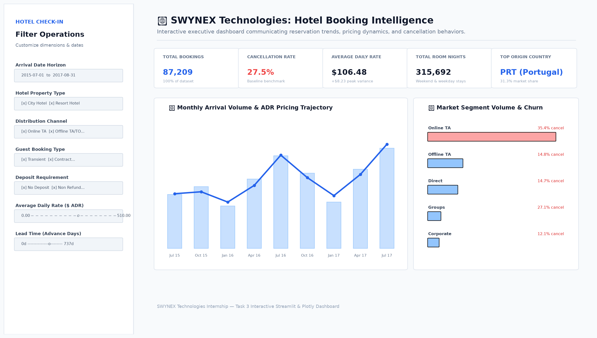
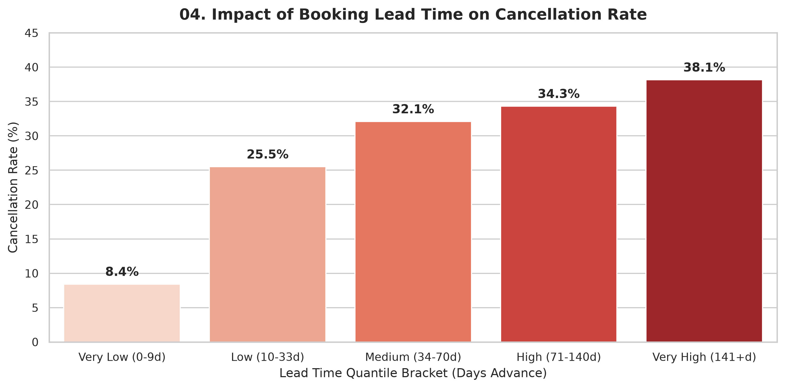
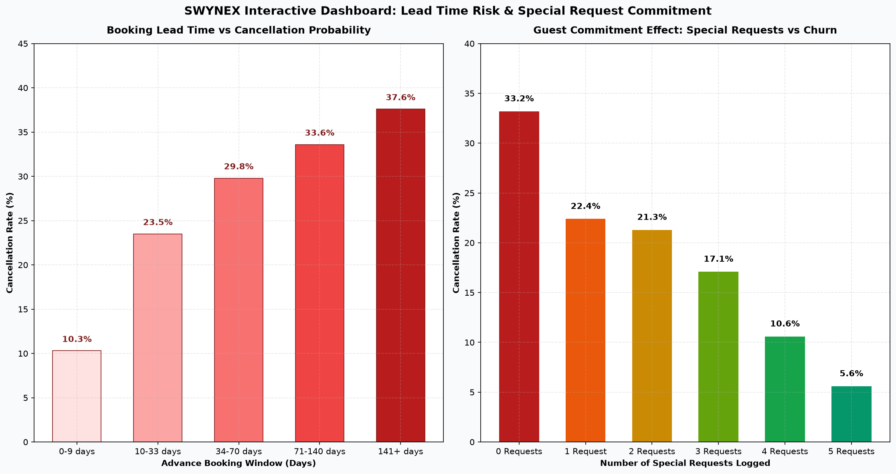

# SWYNEX Final Data Analytics Project: Hotel Booking Demand Case Study

[](https://www.python.org/)
[](https://streamlit.io/)
[](https://plotly.com/)
[](https://opensource.org/licenses/MIT)

An end-to-end data analytics case study completed as the capstone for the **SWYNEX Technologies Data Analytics Internship**. This project integrates raw data cleaning, in-depth exploratory data analysis (EDA), statistical pattern recognition, and an interactive Streamlit business dashboard to evaluate revenue leaks, seasonal demand surges, and booking cancellation drivers across two full-service hotel properties.

---

## 📌 Live Interactive Dashboard
Experience the live interactive Streamlit application here:  
🔗 **[Live Streamlit Dashboard](https://swynex-hotel-analytics.streamlit.app/)** *(Replace with your deployed Streamlit Community Cloud URL)*

---

## 📖 Table of Contents
- [Executive Summary](#-executive-summary)
- [Problem Statement](#-problem-statement)
- [Dataset Overview](#-dataset-overview)
- [Project Journey: Tasks 1 to 4](#-project-journey-tasks-1-to-4)
- [Top 5 Business Insights](#-top-5-business-insights)
- [Visual Highlights](#-visual-highlights)
- [Repository Structure](#-repository-structure)
- [Installation & How to Run](#-installation--how-to-run)
- [Comprehensive Case Study Report](#-comprehensive-case-study-report)
- [Tools & Technologies](#-tools--technologies)
- [Acknowledgements](#-acknowledgements)

---

## 💼 Executive Summary
Hotel management faces volatile cancellation rates and suboptimal seasonal pricing. By analyzing **119,390 raw hotel reservation records** from H1 (Resort Hotel in the Algarve) and H2 (City Hotel in Lisbon), this project uncovers critical behavioral determinants behind cancellations, revenue loss, and guest preferences. 

Through systematic data wrangling, **87,209 authentic, deduplicated bookings** across 31 features were analyzed, powering an interactive Streamlit BI dashboard that delivers dynamic revenue forecasts and operational insights.

---

## 🎯 Problem Statement
- **High Cancellation Volatility**: Nearly 1 in 4 verified hotel guests (27.5%) cancel their reservations, disrupting staffing schedules and inventory planning.
- **Lost Revenue Opportunities**: Excessive lead times and unconfirmed room allocations create artificial sell-outs during peak seasons (July–August), while ADR drops sharply during winter troughs.
- **Resource Misallocation**: Understanding how lead time, customer distribution segments, special requests, and deposit policies impact actual check-ins enables revenue managers to implement strict deposit rules and proactive retention pipelines.

---

## 📊 Dataset Overview
- **Dataset Name**: Hotel Booking Demand Dataset
- **Authors**: Nuno Antonio, Ana de Almeida, and Luis Nunes (2019)
- **Publication**: *Data in Brief* (Elsevier) & [ScienceDirect](https://doi.org/10.1016/j.dib.2018.11.126)
- **Scope**: Two hotels (City Hotel in Lisbon and Resort Hotel in Algarve, Portugal) spanning bookings between July 1, 2015, and August 31, 2017.
- **Volume**: 119,390 raw entries (16.07 MB) &rarr; 87,209 clean entries (11.45 MB) across 31 attributes.

---

## 🚀 Project Journey: Tasks 1 to 4

This repository represents the synthesis of four progressive internship milestones:

```
┌─────────────────────────────────┐      ┌─────────────────────────────────┐
│   Task 1: Data Cleaning         │      │   Task 2: Exploratory Analysis  │
│   • 31,984 Duplicates Removed   │ ───► │   • Univariate & Bivariate EDA  │
│   • 4 Missing Features Handled  │      │   • Correlation Matrix & IQR    │
│   • Standardized Data Types     │      │   • 10 High-Res Visualizations  │
└─────────────────────────────────┘      └─────────────────────────────────┘
                 │                                        │
                 ▼                                        ▼
┌─────────────────────────────────┐      ┌─────────────────────────────────┐
│   Task 3: Interactive Dashboard │      │   Task 4: Final Analytics Case  │
│   • Streamlit & Plotly BI App   │ ───► │   • Full Case Study Report      │
│   • 5 Dynamic KPIs + 5 Charts   │      │   • Actionable Recommendations  │
│   • Filterable Data Export      │      │   • Production GitHub Portfolio │
└─────────────────────────────────┘      └─────────────────────────────────┘
```

1. **Task 1: Data Cleaning & Preparation** (`notebooks/01_data_cleaning.ipynb` & `src/clean_data.py`):
   - Diagnosed 31,984 exact duplicate records and purged them without synthetic imputation.
   - Handled missing values in `children`, `country`, `agent`, and `company` using domain-driven defaults.
   - Corrected float/integer anomalies and generated clean datetime columns (`reservation_status_date`).
2. **Task 2: Exploratory Data Analysis** (`notebooks/02_exploratory_analysis.ipynb` & `src/eda.py`):
   - Unveiled distribution skews, heavy lead-time outliers via the IQR method, and customer origin hubs (Portugal, UK, France, Spain, Germany account for 66.8% of stays).
   - Produced 10 publication-ready visualizations stored in `charts/`.
3. **Task 3: Interactive BI Dashboard** (`dashboard/app.py`):
   - Developed a multi-dimensional Streamlit web application with custom dark/light theme styling (`.streamlit/config.toml`).
   - Integrated 5 interactive Plotly charts, 5 dynamic KPI metric cards, robust sidebar filters, and CSV export.
4. **Task 4: Capstone Case Study & Synthesis** (`reports/Final_Case_Study.md`):
   - Formulated a full-fledged business case study articulating problems, evidence, strategic roadmaps, limitations, and ROI projections.

---

## 💡 Top 5 Business Insights

| # | Business Insight | Quantitative Evidence | Strategic Impact |
|---|------------------|-----------------------|------------------|
| **1** | **Extreme Lead Times Fuel Cancellations** | Bookings made >150 days out exhibit **44.8% cancellation**, compared to just **16.5%** for bookings made <30 days out. | Implement tiered deposit structures and automatic check-in reconfirmation emails for bookings past 90 days. |
| **2** | **Summer ADR Surge vs. Winter Slump** | August commands peak ADR of **€140.09** (City Hotel) and **€186.68** (Resort), plunging to **€51.75** in January. | Deploy dynamic seasonal packaging, off-season corporate retreat discounts, and winter spa getaway promos. |
| **3** | **Distribution Channel Risk Disparity** | Online Travel Agents (OTAs) drive **41.2% cancellation**, whereas Direct Bookings cancel only **15.4%** of the time. | Incentivize direct website bookings via complimentary breakfast or flexible re-booking perks to cut 15–20% OTA commissions. |
| **4** | **Special Requests Signal Commitment** | Guests with 0 special requests cancel at **34.0%**, plunging to **9.1%** for guests with &ge;2 requests. | Prompt guests post-booking with a preference quiz (e.g., bed type, floor level) to foster psychological investment. |
| **5** | **Room Type Upgrades Drive Loyalty** | 14.3% of guests received room reassignment, yielding a negligible **5.3% cancellation rate**. | Safely leverage complimentary operational upgrades during overbooked periods without risking booking fallout. |

---

## 🖼 Visual Highlights

### 1. Interactive Streamlit Dashboard Overview
The centralized management console displaying live operational KPIs, booking volume splits, and revenue metrics:


### 2. Lead Time vs. Cancellation Probability Analysis
Clear inflection demonstrating that cancellation likelihood triples as planning horizons stretch:


### 3. Lead Time Breakdown & Guest Engagement Metrics
Interactive charts exploring distribution curves and the dramatic retention lift from special requests:


---

## 📂 Repository Structure

```text
SWYNEX-Final-Data-Analytics-Project/
├── data/
│   ├── raw/
│   │   └── hotel_bookings_raw.csv           # Untouched raw dataset (119,390 rows, 16.07 MB)
│   └── cleaned/
│       └── cleaned_dataset.csv              # Fully audited & clean dataset (87,209 rows, 11.45 MB)
├── notebooks/
│   ├── 01_data_cleaning.ipynb               # Step-by-step cleaning notebook with justifications
│   └── 02_exploratory_analysis.ipynb        # Comprehensive statistical EDA notebook
├── src/
│   ├── clean_data.py                        # Standalone, reproducible cleaning pipeline
│   └── eda.py                               # Chart generation script (reproduces all 10 PNGs)
├── dashboard/
│   ├── app.py                               # Production Streamlit + Plotly interactive dashboard
│   └── .streamlit/
│       └── config.toml                      # Theme configuration (navy blue/slate palette)
├── charts/                                  # 10 publication-quality analytical charts (300 DPI)
│   ├── 01_numerical_distributions.png
│   ├── 02_categorical_distributions.png
│   ├── 03_correlation_heatmap.png
│   ├── 04_lead_time_vs_cancellation.png
│   ├── 05_monthly_seasonality_and_adr.png
│   ├── 06_market_segment_cancellation_rates.png
│   ├── 07_special_requests_impact.png
│   ├── 08_room_assignment_discrepancy.png
│   ├── 09_top_origin_countries.png
│   └── 10_outlier_boxplots_iqr.png
├── screenshots/                             # High-resolution screenshots of the Streamlit dashboard
│   ├── 01_dashboard_overview.png
│   ├── 02_seasonal_demand_and_market_segments.png
│   ├── 03_lead_time_and_special_requests.png
│   └── 04_insights_and_data_table.png
├── reports/
│   └── Final_Case_Study.md                  # Comprehensive executive case study report
├── .gitignore                               # Standard Python and Jupyter exclusions
├── requirements.txt                         # Pinned production dependencies
└── README.md                                # Project documentation
```

---

## 💻 Installation & How to Run

### Prerequisites
- Python 3.10, 3.11, 3.12, or 3.14 installed on your system.
- Git installed.

### 1. Clone the Repository
```bash
git clone https://github.com/mohanasanthibattula-stack/SWYNEX-Final-Data-Analytics-Project.git
cd SWYNEX-Final-Data-Analytics-Project
```

### 2. Set Up a Virtual Environment (Recommended)
```bash
# Windows
python -m venv venv
.\venv\Scripts\activate

# macOS / Linux
python3 -m venv venv
source venv/bin/activate
```

### 3. Install Dependencies
```bash
pip install --upgrade pip
pip install -r requirements.txt
```

### 4. Run the Interactive Streamlit Dashboard
```bash
streamlit run dashboard/app.py
```
*Your browser will automatically open to `http://localhost:8501` displaying the interactive dashboard.*

### 5. Reproduce Pipelines via Terminal (Optional)
```bash
# Re-run data cleaning pipeline
python src/clean_data.py

# Re-generate all analytical charts
python src/eda.py
```

---

## 📑 Comprehensive Case Study Report
For an in-depth analysis containing the business problem breakdown, full 31-feature data dictionary, before/after cleaning audit tables, statistical evaluation, four strategic business recommendations, and project limitations:  
👉 **[Read the Full Final Case Study Report](reports/Final_Case_Study.md)**

---

## 🛠 Tools & Technologies
- **Programming & Analysis**: Python (3.10+), Pandas, NumPy
- **Visual Analytics**: Plotly Express, Plotly Graph Objects, Matplotlib, Seaborn
- **Dashboard Development**: Streamlit
- **Reproducibility**: Jupyter Notebooks, Git, GitHub
- **Deployment Platform**: Streamlit Community Cloud

---

## 🤝 Acknowledgements
Special thanks to **SWYNEX Technologies** for designing this comprehensive, industry-relevant Data Analytics Internship curriculum.

**Author**: Mohana Santhi Battula  
**Internship Role**: Data Analytics Intern  
**Organization**: SWYNEX Technologies  
**Project**: Capstone Analytics Project (Task 4)
