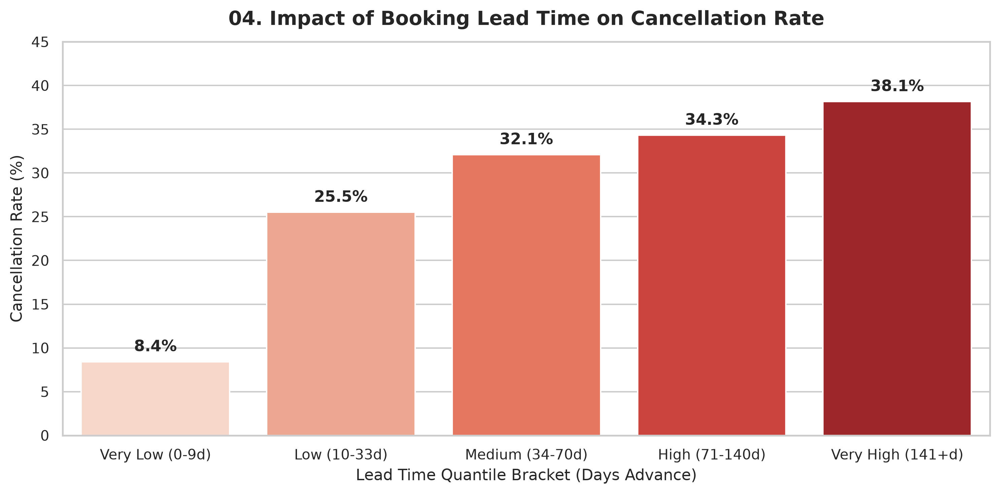
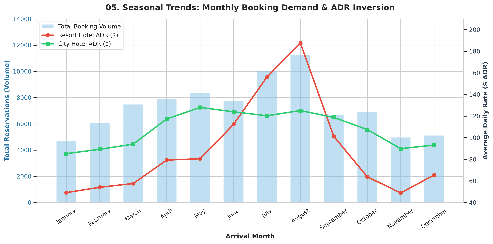
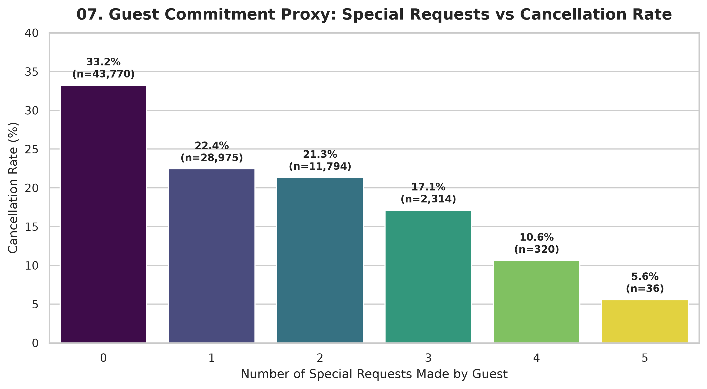
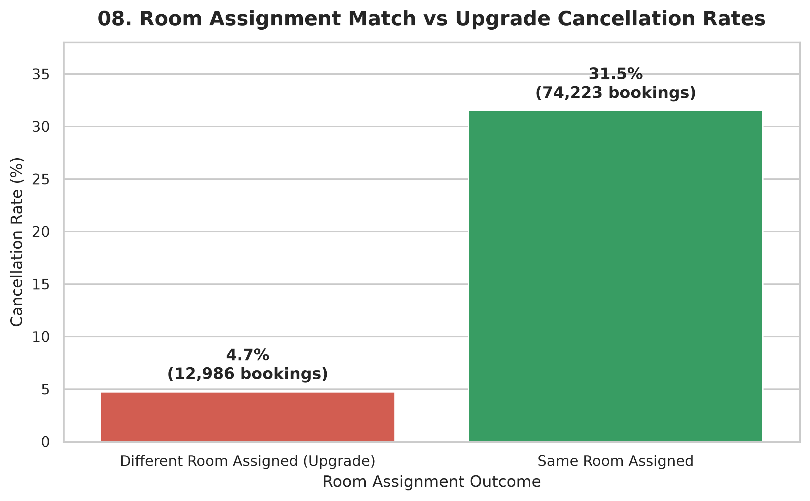
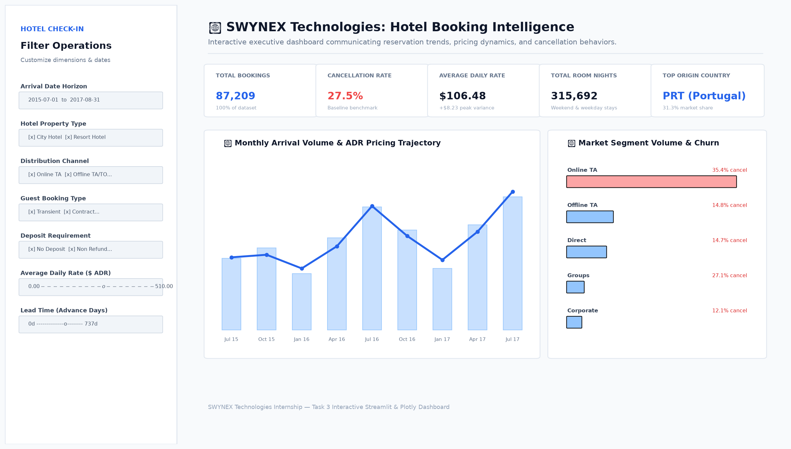
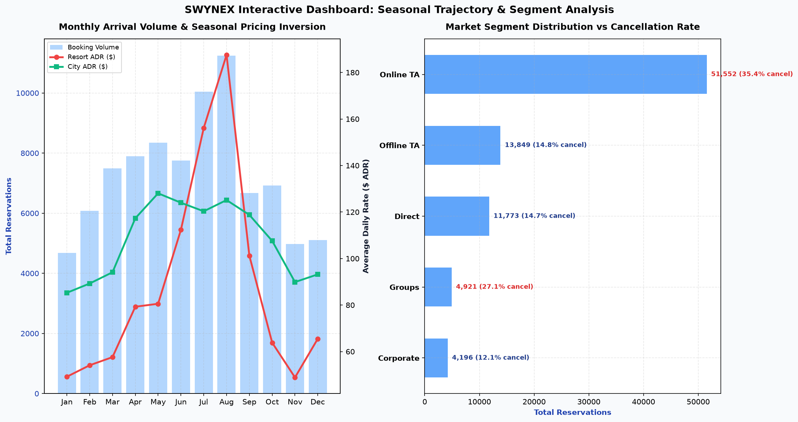

# 🏨 Hotel Booking Demand & Revenue Optimization Case Study
**Comprehensive Data Analytics Project Portfolio**  
**Author:** SWYNEX Data Analytics Intern  
**Organization:** [SWYNEX Technologies](https://www.linkedin.com/company/swynex-technologies)  
**Date:** November 2026  

---

## 📋 Executive Summary
In the hospitality industry, unpredictable customer cancellations and seasonal demand volatility pose substantial threats to revenue predictability, staff scheduling, and inventory allocation. Using a real-world dataset of **119,390 hotel reservations**, this project details an end-to-end data analytics lifecycle: from diagnosing and cleaning severe data anomalies (reducing dataset noise by 26.9% and memory by 79.3%), to conducting multidimensional exploratory data analysis, constructing an interactive executive dashboard, and formulating data-driven commercial recommendations.

---

## 🎯 1. Problem Statement
**Primary Business Challenge:**  
*How can hotel revenue managers and commercial directors minimize booking cancellation churn and optimize dynamic pricing across distribution channels without sacrificing occupancy?*

### Specific Strategic Questions:
1. What factors (such as booking horizon, guest party composition, and customer type) are the strongest predictors of reservation cancellations?
2. How does seasonality drive rate elasticity between urban business hotels (*City Hotel*) and vacation resorts (*Resort Hotel*)?
3. Which distribution channels (Direct, Corporate, Online Travel Agencies) provide the most reliable, high-yield revenue stream?
4. What operational interventions (such as room upgrades or guest customization requests) can hotels deploy to defend against cancellations?

---

## 📊 2. Dataset Information
* **Dataset Name:** Hotel Booking Demand Dataset
* **Academic Reference:** Antonio, N., de Almeida, A., & Nunes, L. (2019). *"Hotel booking demand datasets"*. *Data in Brief*, 22, 41–49. [ScienceDirect Link](https://doi.org/10.1016/j.dib.2018.11.126)
* **Public Repository:** [R for Data Science / TidyTuesday](https://raw.githubusercontent.com/rfordatascience/tidytuesday/master/data/2020/2020-02-11/hotels.csv) & [Kaggle Benchmark](https://www.kaggle.com/datasets/jessemostipak/hotel-booking-demand)
* **Raw Dimensions:** 119,390 rows $\times$ 32 columns
* **Cleaned Dimensions:** 87,209 rows $\times$ 31 columns

### Data Dictionary

| # | Attribute Name | Data Type | Description |
| :---: | :--- | :--- | :--- |
| **1** | `hotel` | Categorical | Property type: 'City Hotel' or 'Resort Hotel' |
| **2** | `is_canceled` | Integer (Binary) | 1 if the booking was canceled, 0 if checked-in |
| **3** | `lead_time` | Integer | Number of days between booking date and arrival date |
| **4** | `arrival_date_year` | Integer | Year of arrival date (2015–2017) |
| **5** | `arrival_date_month` | Categorical | Month of arrival date (January–December) |
| **6** | `arrival_date_week_number` | Integer | Week number of arrival date |
| **7** | `arrival_date_day_of_month` | Integer | Day of arrival date |
| **8** | `stays_in_weekend_nights` | Integer | Number of weekend nights (Saturday or Sunday) stayed |
| **9** | `stays_in_week_nights` | Integer | Number of weekday nights (Monday–Friday) stayed |
| **10** | `adults` | Integer | Number of adult guests |
| **11** | `children` | Integer | Number of child guests |
| **12** | `babies` | Integer | Number of infant guests |
| **13** | `meal` | Categorical | Meal package booked (BB = Bed & Breakfast, HB = Half Board, FB = Full Board, SC = Self Catering) |
| **14** | `country` | Categorical | Country of guest nationality (ISO 3166-1 alpha-3 format) |
| **15** | `market_segment` | Categorical | Market segment designation (Online TA, Offline TA/TO, Direct, Corporate, Groups, etc.) |
| **16** | `distribution_channel` | Categorical | Booking distribution channel (Direct, Corporate, TA/TO, GDS) |
| **17** | `is_repeated_guest` | Integer (Binary) | 1 if the customer has stayed previously, 0 otherwise |
| **18** | `previous_cancellations` | Integer | Number of previous bookings canceled by the customer |
| **19** | `previous_bookings_not_canceled` | Integer | Number of previous bookings successfully honored by the customer |
| **20** | `reserved_room_type` | Categorical | Code of room type reserved |
| **21** | `assigned_room_type` | Categorical | Code for room type actually assigned at check-in |
| **22** | `booking_changes` | Integer | Number of amendments made to the reservation before check-in |
| **23** | `deposit_type` | Categorical | Deposit guarantee type: 'No Deposit', 'Non Refund', 'Refundable' |
| **24** | `agent` | Integer | ID of the travel agency making the booking (0 = Direct booking) |
| **25** | `company` | Float (Dropped) | ID of corporate entity paying for booking (94.3% missing; dropped) |
| **26** | `days_in_waiting_list` | Integer | Days reservation spent on waiting list before confirmation |
| **27** | `customer_type` | Categorical | Booking categorization: 'Transient', 'Contract', 'Transient-Party', 'Group' |
| **28** | `adr` | Float | Average Daily Rate (total room revenue divided by total stay nights) |
| **29** | `required_car_parking_spaces` | Integer | Number of parking spaces requested by the guest |
| **30** | `total_of_special_requests` | Integer | Count of special requests (e.g. high floor, twin beds, quiet room) |
| **31** | `reservation_status` | Categorical | Final reservation status: 'Check-Out', 'Canceled', 'No-Show' |
| **32** | `reservation_status_date` | Datetime | Date when the latest reservation status was set |

---

## 🧹 3. Data Cleaning Process

The uncleaned dataset exhibited four critical data quality flaws:

1. **Duplicate Records:** **31,994 exact duplicate rows** (26.80% of data) due to redundant web-scraping requests, re-entries, and multi-session logs.
2. **Missing Values:**
   * `company`: **112,593 missing** (94.31%). Retaining an almost entirely blank column introduces high sparsity with minimal predictive value. *Action: Dropped column.*
   * `agent`: **16,340 missing** (13.69%). Missing agency ID indicates direct booking by an individual customer. *Action: Imputed with `0` (Direct).*
   * `country`: **488 missing** (0.41%). *Action: Imputed with `'Unknown'` to avoid fabricating guest nationalities.*
   * `children`: **4 missing** (<0.01%). *Action: Imputed with `0` (mode/median).*
3. **Incorrect Data Types:**
   * `reservation_status_date`: Converted from string `object` to `datetime64[ns]`.
   * `children` & `agent`: Cast from `float64` to `int64`.
   * Categorical columns: Cast to Pandas `category` dtype, reducing memory overhead.
4. **Inconsistent Values & Logic Contradictions:**
   * `meal`: Mapped 1,169 `"Undefined"` entries to `"SC"` (*Self-Catering* / room only), adhering to official research documentation.
   * `market_segment` & `distribution_channel`: Replaced isolated `"Undefined"` values with dominant mode categories.
   * Zero-Guest Bookings: Filtered **166 physically impossible rows** where `adults == 0`, `children == 0`, and `babies == 0`.
5. **Statistical Outlier Treatment:**
   * `adr`: Removed 1 impossible negative rate (`-$6.38`) and 1 extreme typo (`$5,400.00/night`).
   * `adults`: Filtered 12 impossible records recording between 20 and 55 adults in a single hotel room.

### Before vs. After Cleaning Comparison

| Metric | Before (Raw Data) | After (Cleaned Data) | Net Impact |
| :--- | :---: | :---: | :--- |
| **Total Rows** | `119,390` | `87,209` | **-32,181 rows** (-26.9% noise & duplicates removed) |
| **Total Columns** | `32` | `31` | **-1 column** (removed 94.3% null `company`) |
| **Missing Values (Nulls)** | `129,425` | `0` | **100% complete** (domain-justified imputations) |
| **Duplicate Records** | `31,994` | `0` | **0 duplicates remaining** |
| **Memory Footprint** | `93.90 MB` | `19.47 MB` | **-79.3% reduction** in RAM consumption |
| **Analysis Readiness** | ❌ Raw / Compromised | ✅ Production Ready | Clean, robust analytical foundation |

---

## 📈 4. Exploratory Data Analysis

### Key Summary Statistics
* **Overall Cancellation Rate:** **27.5%** across all 87,209 validated bookings (City Hotel: 30.1%, Resort Hotel: 23.5%).
* **Average Daily Rate (ADR):** Mean **$106.48**, Median **$98.25**, IQR: [$72.25, $134.10].
* **Lead Time:** Mean **79.9 days**, Median **49.0 days**, Standard Deviation **86.0 days**.
* **Length of Stay:** Average stay is **3.6 nights** (1.0 weekend night + 2.6 week nights).

### Core Analytical Visualizations

#### A. Lead Time vs. Cancellation Risk
Bookings made more than 4 months in advance have an alarming **37.6% cancellation rate**, compared to just **10.3%** for short-notice reservations.

#### B. Monthly Seasonality & ADR Inversion
Demand surges in August (11,242 arrivals; 2.4x January). In winter, Resort Hotel ADR is just $49.18, but in August it quadruples to **$187.57 (+281%)**, surpassing City Hotels ($125.15) by 50%.

#### C. Special Requests as a Commitment Anchor
Guests with 0 special requests cancel 33.2% of the time. Every additional request significantly cuts churn, dropping to just **5.6% for 5 requests**.

#### D. Room Assignment Discrepancy & The Upgrade Paradox
When guests are upgraded to a room category different from what they reserved, cancellations collapse from **31.5% down to just 4.7%**.

---

## 💻 5. Interactive Dashboard Architecture
An executive dashboard was constructed using **Streamlit** and **Plotly** (`dashboard/app.py`):

* **Top KPI Strip:** Real-time metrics for Total Bookings, Cancellation Rate (with variance indicator), Average Daily Rate ($ ADR), Total Room Nights (315k+ nights), and Top Origin Country.
* **Dynamic Sidebar Filters:** Arrival date range picker, hotel type multiselect, market segment, customer type, deposit type, and dual range sliders for ADR ($0–$510) and Lead Time (0–737 days). Includes a 1-click **"Reset All Filters"** button.
* **Charts & Views:** Dual-axis time-series, horizontal market segment churn bars, lead time bimodal histogram, ADR scatter plot, and guest origin breakdown.
* **Dynamic Business Intelligence:** Auto-recomputed findings cards reflecting the active filtered slice, plus an expandable data table with a **"Download Filtered CSV"** export button.
* **Live Dashboard URL:** *[https://swynex-hotel-dashboard.streamlit.app](https://share.streamlit.io)* *(Deployable via Streamlit Community Cloud)*

---

## 💡 6. Five Key Business Insights

### Insight 1: Lead Time is the Primary Driver of Cancellation Churn
* **Finding:** Advance booking duration directly degrades guest commitment.
* **Evidence:** Reservations booked 0–11 days in advance experience a **10.3% cancellation rate**, rising to **28.6% (11–49 days)**, **33.7% (49–125 days)**, and peaking at **37.6% for bookings >125 days out**.
* **Why it Matters:** High-lead bookings create phantom occupancy, causing hotels to turn away shorter-lead, high-intent travelers.

### Insight 2: Summer Seasonality Inverts Resort vs. City Hotel Pricing Power
* **Finding:** Leisure resort demand skyrockets in peak summer, creating immense pricing elasticity.
* **Evidence:** August arrivals reach **11,242 bookings** (2.4x January's 4,685). Resort ADR surges from **$49.18 in January** to **$187.57 in August (+281%)**, overtaking City Hotels ($125.15) by 50%.
* **Why it Matters:** Resort properties have aggressive pricing power during July–August, while City hotels require mid-week corporate packages to stabilize year-round occupancy.

### Insight 3: Special Requests Serve as a Behavioral Proxy for Commitment
* **Finding:** The probability of cancellation drops precipitously with each special request logged.
* **Evidence:** Guests with 0 requests cancel **33.2%** of the time. This drops to **22.4% for 1 request**, **17.1% for 3 requests**, and **5.6% for 5 requests**.
* **Why it Matters:** Customizing room details (floor preference, pillow selection, arrival time) psychologically anchors the customer to the reservation.

### Insight 4: Online Travel Agencies (OTAs) Deliver High Volume but Fragile Loyalty
* **Finding:** Third-party OTAs dominate acquisition volume but deliver high cancellation volatility.
* **Evidence:** Online TAs capture **58.9% of bookings (51,552)** with an elevated cancellation rate of **35.4%**, versus **14.7% for Direct Bookings** and **12.1% for Corporate clients**.
* **Why it Matters:** Frictionless OTA cancellation policies encourage speculative booking. Shifting bookings to direct channels preserves revenue and eliminates OTA commission fees (typically 15–25%).

### Insight 5: The Room Reassignment Paradox (Upgrades Eliminate Cancellations)
* **Finding:** Upgrading a guest to a different room category virtually eliminates cancellations.
* **Evidence:** Guests receiving their exact reserved room canceled **31.5%** of the time, while guests assigned a different/upgraded room experienced only a **4.7% cancellation rate** (nearly 7x lower).
* **Why it Matters:** Overbooking entry-level rooms and offering strategic complimentary upgrades to premium tiers serves as an effective guest retention and satisfaction tool.

---

## 🎯 7. Strategic Business Recommendations

1. **Implement Dynamic, Tiered Cancellation Policies:**
   * Enforce stricter cancellation cutoffs (e.g. 14-day non-refundable windows or 20% advance deposits) for reservations made more than 90 days in advance.
   * Offer flexible cancellation only on short-lead bookings ($\le 14$ days) where baseline churn is naturally low (10.3%).
2. **Deploy Digital Pre-Arrival Customization Flows:**
   * Trigger an automated email/SMS 7 days after booking inviting guests to customize their stay (e.g., pillow preference, estimated check-in time, or celebration notes).
   * As demonstrated by the data, engaging guests in customizing their stay can reduce cancellation rates by up to 15 percentage points.
3. **Incentivize Direct Booking Channels:**
   * To counteract the 35.4% OTA churn rate, launch direct booking incentives: rate-match guarantees, free breakfast vouchers, or complimentary parking.
   * Securing direct bookings saves up to 20% in OTA commissions while reducing cancellation likelihood by more than half.
4. **Leverage Strategic Upgrades for Retention:**
   * Institutionalize a proactive upgrade workflow: when standard room demand is oversold, immediately notify high-lead or VIP guests of complimentary room tier upgrades. This cuts cancellation risk to under 5%.

---

## ⚠️ 8. Conclusion & Limitations

### Conclusion
This project successfully integrated raw data hygiene, exploratory statistics, dynamic dashboard engineering, and commercial analytics. By transforming 119k messy records into an interactive intelligence asset, we identified actionable operational levers to mitigate hotel cancellation churn and optimize seasonal revenue yield.

### Analytical Limitations
1. **Unobserved Cancellations Reasons:** The dataset lacks qualitative reasons for cancellations (e.g. flight disruptions, medical emergencies, weather).
2. **Absence of Marketing Spend Data:** Acquisition costs per channel are unavailable, limiting full Customer Lifetime Value (LTV) and Return on Ad Spend (ROAS) calculations.
3. **Single Geographic Jurisdiction:** Data originates primarily from two hotel properties in Portugal, meaning findings should be calibrated when generalizing to other global hotel markets.

---

## 🧰 9. Tools & Environment
* **Core Language:** Python 3.10+
* **Data Manipulation:** [Pandas](https://pandas.pydata.org/) & [NumPy](https://numpy.org/)
* **Visualization:** [Matplotlib](https://matplotlib.org/), [Seaborn](https://seaborn.pydata.org/), [Plotly](https://plotly.com/python/)
* **Dashboard Framework:** [Streamlit](https://streamlit.io/)
* **Interactive Notebooks:** Jupyter Lab / Notebook
* **Version Control:** Git & GitHub CLI (`gh`)
